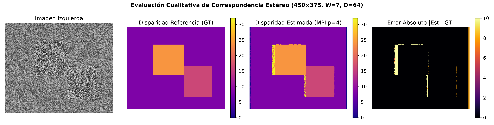
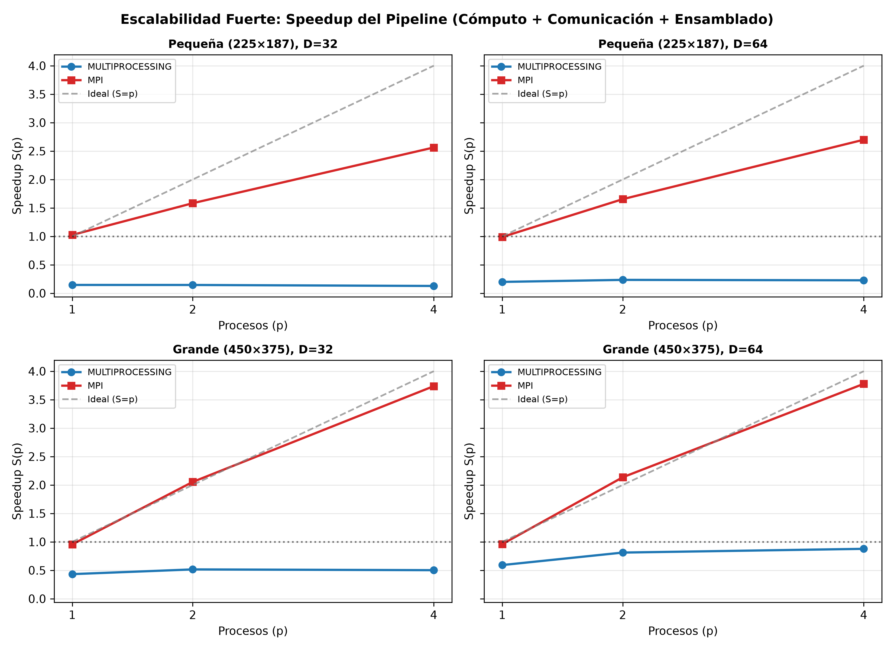
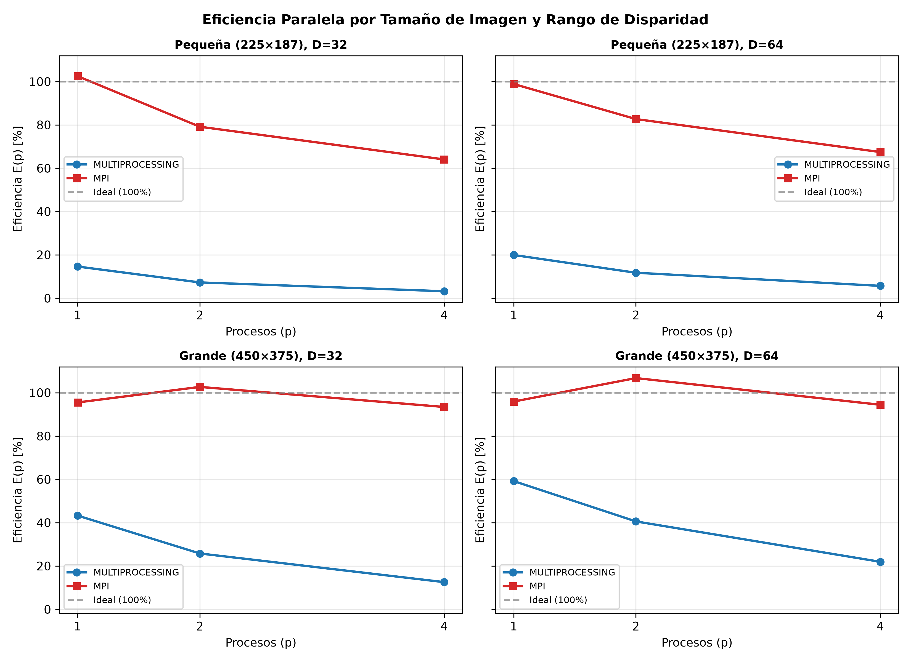
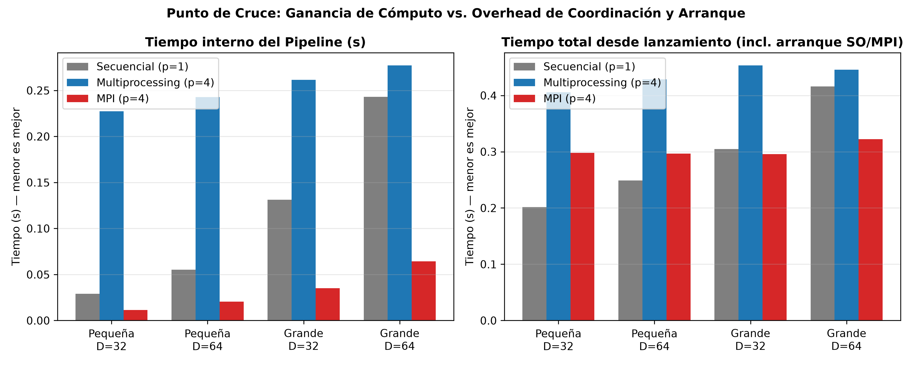

# Visión Estéreo Paralela y Distribuida (SAD)

Implementación y análisis comparativo de correspondencia estéreo densa por ventanas —**Suma de Diferencias Absolutas (SAD)**— ejecutada en tres modalidades: **secuencial**, **paralela en memoria compartida (`multiprocessing`)** y **distribuida por paso de mensajes (`mpi4py`)**.

El objetivo no es solo construir el mapa de disparidad, sino medir y demostrar **a partir de qué resolución y rango de disparidad** el paralelismo supera a la línea base secuencial cuando se incluyen los costos reales de partición, *halos*, comunicación, ensamblado y arranque de procesos.

*Proyecto del curso de Computación Paralela y Distribuida — Universidad Peruana Cayetano Heredia.*

---

## 1. Demostración visual

A partir de un par estéreo rectificado (imagen izquierda y derecha), el algoritmo estima el mapa de disparidad y se valida frente al *ground truth* (resolución `450×375`, ventana `7×7`, `D = 64`):



> **Verificación de exactitud:** las **84 corridas experimentales** (28 configuraciones × 3 repeticiones) produjeron mapas **100% idénticos byte a byte** frente a la línea base secuencial (`salida_identica = True`), con un MAE entre `0.19` y `0.67 px`.

---

## 2. El algoritmo, paso a paso

### Correspondencia estéreo por ventanas (SAD)
Para cada píxel `(x, y)` y cada disparidad candidata `d ∈ [0, D - 1]`, se compara una ventana `K × K` (con `K = 7`, radio `r = 3`) en la imagen izquierda contra la imagen derecha desplazada `d` píxeles a lo largo de la línea epipolar horizontal:

```text
Par rectificado (I_L, I_R)  ─►  Desplazamiento d ∈ [0, D-1]  ─►  Suma SAD (ventana 7×7)  ─►  argmin(costo) = Disparidad
```

La complejidad escala como `O(H · W · D · K²)`, por lo que el costo crece rápidamente al aumentar la resolución o el rango de disparidad `D`.

### Partición por franjas horizontales y manejo de *halos*
Para repartir el trabajo entre `p` procesos sin introducir errores en los bordes de corte, cada franja `[y0, y1)` incluye **3 filas adicionales de solapamiento (*halo*)** arriba y abajo (`r = K // 2 = 3`):

```text
Imagen completa (H × W)  ─►  p franjas + halos (r = 3)  ─►  Cómputo SAD local  ─►  np.vstack() = Mapa final
```

En los extremos superior e inferior de la imagen se aplica relleno por replicación (`mode="edge"`), garantizando equivalencia matemática exacta con la ejecución secuencial.

---

## 3. Las tres modalidades

| Modalidad | Cómo procesa la imagen | Tecnología |
| :--- | :--- | :--- |
| **Secuencial** | Un solo proceso recorre toda la imagen (línea base). | Python + NumPy |
| **Multiprocessing** | Divide en `p` franjas con *halos* y las reparte con `Pool.map()`. | `multiprocessing.Pool` |
| **MPI** | Sincroniza con `Barrier()`, distribuye franjas con `scatter()` y reúne con `gather()`. | `mpi4py` + MS-MPI / OpenMPI |

Las tres modalidades comparten exactamente el mismo núcleo de cómputo (`src/common/stereo_core.py`), lo que garantiza una comparación justa.

---

## 4. Batería de pruebas

Se evaluaron dos resoluciones compatibles con el estándar **Middlebury Stereo (2003)** y dos rangos de disparidad (`D = 32` y `D = 64`), variando `p ∈ {1, 2, 4}` con **3 repeticiones** por configuración (reportando la **mediana**):

| Dataset | Dimensiones | Píxeles | Rangos de disparidad (`D`) | Ventana (`K`) |
| :--- | :---: | :---: | :---: | :---: |
| `middlebury_cones_small` | `225 × 187` | ~0.042 MP | `32`, `64` | `7 × 7` |
| `middlebury_cones` | `450 × 375` | ~0.169 MP | `32`, `64` | `7 × 7` |

Se registraron dos alcances temporales:
1. **Tiempo interno del pipeline (`T_pipe`):** cómputo + comunicación + ensamblado.
2. **Tiempo total desde lanzamiento (`T_lanz`):** incluye arranque del intérprete Python y `mpiexec`.

---

## 5. Resultados

### Escalabilidad fuerte: Speedup del pipeline
En el tiempo interno del pipeline, **MPI** escala casi linealmente en la carga más pesada (`450×375, D=64`), alcanzando un **speedup de 3.78×** con 4 procesos (pasando de `4.11 FPS` a `15.54 FPS`):



### Eficiencia paralela
MPI alcanza hasta **94.5% de eficiencia** con `p = 4` en `450×375, D=64`. En `p = 2` se observa eficiencia levemente superlineal (**102.7% – 106.8%**) debido a una mejor localidad de las submatrices en las cachés L2/L3 del procesador:



### El punto de cruce: Cómputo vs. Overhead de arranque
Al comparar el tiempo interno del pipeline frente al tiempo total desde el lanzamiento (`p = 4` vs. secuencial), se observa con claridad el punto de cruce:
- **En `225×187`:** el arranque de `mpiexec` (~0.25 s) domina y genera *slowdown* en tiempo total (`0.68× – 0.84×`).
- **En `450×375, D=64`:** **MPI supera al secuencial incluso pagando el arranque (`1.29×`)**.
- **Multiprocessing en Windows:** pierde en todos los casos de un solo *frame* (`S_pipe ≤ 0.88×`) por el costo fijo del mecanismo `spawn` (~0.17–0.21 s).



### Tabla resumen (medianas de 3 repeticiones, `450×375`)

| Escenario | Modo | `p` | `T_pipe` (s) | `S_pipe` | `E_pipe` | `T_lanz` (s) | `S_lanz` | Comm (ms) | Bytes |
| :--- | :--- | :---: | :---: | :---: | :---: | :---: | :---: | :---: | :---: |
| Large, D=32 | Secuencial | 1 | 0.1313 | 1.00× | 100.0% | 0.3049 | 1.00× | 0.00 | 0 |
| Large, D=32 | Multiprocessing | 4 | 0.2615 | 0.50× | 12.6% | 0.4532 | 0.67× | — | 1,583,550 |
| Large, D=32 | MPI | 4 | **0.0351** | **3.74×** | **93.4%** | **0.2956** | **1.03×** | 2.78 | 1,583,550 |
| Large, D=64 | Secuencial | 1 | 0.2431 | 1.00× | 100.0% | 0.4162 | 1.00× | 0.00 | 0 |
| Large, D=64 | Multiprocessing | 4 | 0.2771 | 0.88× | 21.9% | 0.4456 | 0.93× | — | 1,583,550 |
| Large, D=64 | MPI | 4 | **0.0644** | **3.78×** | **94.5%** | **0.3224** | **1.29×** | 3.48 | 1,583,550 |

*(Los resultados completos de las 84 corridas están en `experiments/results/experimentos_detalle.csv` y `experiments/results/experimentos_resumen.csv`).*

---

## 6. Estructura del proyecto

```text
Proyecto_Paralela_Vision_Estereo/
├── data/
│   ├── descargar_datos.py              # descarga Middlebury o genera respaldo determinista
│   ├── README.md                       # documentación de datasets y transformaciones
│   ├── middlebury_cones/               # resolución grande (450×375)
│   └── middlebury_cones_small/         # resolución pequeña (225×187)
├── src/
│   ├── common/
│   │   └── stereo_core.py              # núcleo SAD vectorizado, halos y métricas (MAE/RMSE)
│   ├── sequential/
│   │   └── stereo_seq.py               # línea base secuencial
│   └── parallel_or_distributed/
│       ├── stereo_mp.py                # versión paralela (multiprocessing.Pool)
│       └── stereo_mpi.py               # versión distribuida (mpi4py: scatter/gather)
├── experiments/
│   ├── comparar_experimentos.py        # suite automática (3 reps + validación byte a byte)
│   ├── generar_graficas.py             # genera las 4 figuras PNG desde el CSV
│   ├── results/                        # CSVs de detalle/resumen y mapas generados
│   ├── figures/                        # gráficas de rendimiento y mapa de error
│   └── report/                         # informe técnico final
├── requirements.txt
├── Dockerfile
├── LICENSE
└── README.md
```

---

## 7. Requisitos

- Python 3.10+
- **Windows:** Microsoft MPI (MS-MPI) instalado para ejecutar `mpiexec`
- **Linux / macOS:** OpenMPI (`sudo apt install openmpi-bin libopenmpi-dev`)
- Dependencias de Python:
  ```bash
  python -m pip install -r requirements.txt
  ```

---

## 8. Uso paso a paso

1. **Preparar los pares estéreo:**
   ```bash
   python data/descargar_datos.py
   ```

2. **Ejecutar una modalidad individual:**
   ```bash
   # Secuencial
   python src/sequential/stereo_seq.py --data data/middlebury_cones --max-disp 64 --out experiments/results/test_seq.png

   # Multiprocessing (4 procesos)
   python src/parallel_or_distributed/stereo_mp.py --data data/middlebury_cones --max-disp 64 --p 4 --out experiments/results/test_mp.png

   # MPI (4 procesos)
   mpiexec -n 4 python src/parallel_or_distributed/stereo_mpi.py --data data/middlebury_cones --max-disp 64 --out experiments/results/test_mpi.png
   ```

3. **Correr la batería completa de experimentos (28 configuraciones × 3 repeticiones):**
   ```bash
   python experiments/comparar_experimentos.py --reps 3
   ```

4. **Generar las 4 gráficas a partir de los resultados:**
   ```bash
   python experiments/generar_graficas.py
   ```

---

## 9. Ejecución con Docker

El repositorio incluye un `Dockerfile` basado en `python:3.11-slim` con OpenMPI preinstalado para reproducir los experimentos en cualquier entorno Linux/Windows con Docker.

**Construir la imagen localmente:**
```bash
docker build -t proyecto5-estereo .
```

**Ejecutar la suite completa de experimentos:**
```bash
docker run --rm proyecto5-estereo
```

**Conservar resultados y gráficas en tu equipo (volumen `-v`):**
```bash
# PowerShell / Linux / macOS
docker run --rm -v "${PWD}/experiments/results:/app/experiments/results" proyecto5-estereo
```

---

## 10. Decisiones técnicas y retos resueltos

- **Equivalencia exacta mediante *halos* (`r = 3`):** cada franja incluye 3 filas vecinas con un incremento de apenas **+4.3%** en bytes transferidos (`1.52 MB → 1.58 MB` al pasar de `p=1` a `p=4`), eliminando por completo los artefactos en bordes.
- **Aritmética `int32` en SAD:** evita desbordamientos al acumular las 49 diferencias absolutas de la ventana `7×7` sobre imágenes en escala de grises (`uint8`).
- **Participación del rango 0 en MPI:** el proceso coordinador también procesa su propia franja, evitando núcleos ociosos y permitiendo evaluar `p = 1` bajo la misma arquitectura.
- **Doble medición temporal (`T_pipe` vs. `T_lanz`):** permite separar la escalabilidad algorítmica real (`3.78×`) del *overhead* de lanzamiento del sistema operativo y de `spawn` en Windows.
- **Respaldo reproducible de datos:** si el servidor de Middlebury devuelve `HTTP 403`, `data/descargar_datos.py` genera automáticamente un par estéreo determinista (`semilla = 42`) con *ground truth* compatible en escala `×4`.

---

## 11. Autor

- **Jander Huamani Salazar** — Diseño, implementación (secuencial, `multiprocessing` y `mpi4py`), suite experimental, análisis de escalabilidad y documentación.
